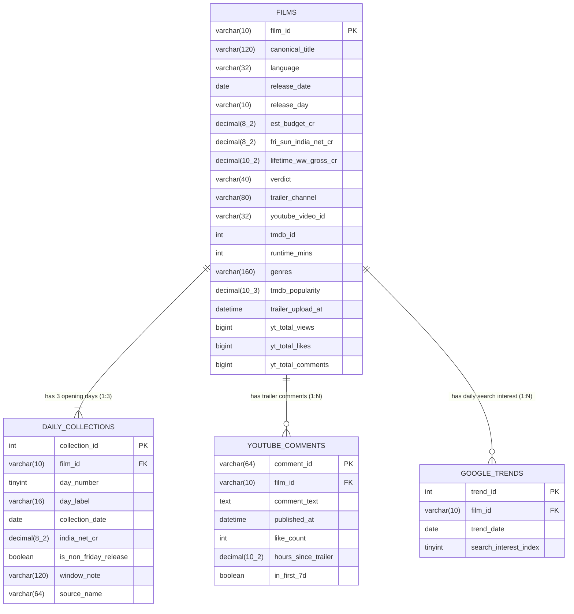

# Release Day Radar — Relational ER Diagram

This schema normalizes all three data shapes (Structured HTML/CSV, Semi-Structured JSON APIs, and Unstructured free-text comments) around the canonical **`film_id`** key (`F01`–`F12`).

## Entity-Relationship Diagram (Mermaid)



## ASCII Relationship Overview

```text
+-----------------------------------+
|              films                |
|-----------------------------------|
| PK  film_id (VARCHAR(10))         |
|     canonical_title, language,    |
|     release_date, est_budget_cr,  |
|     fri_sun_india_net_cr,         |
|     tmdb_id, runtime_mins,        |
|     genres, yt_total_views, ...   |
+-----------------------------------+
   | 1                | 1                | 1
   |                  |                  |
   | 3                | N                | N
   v                  v                  v
+--------------------+ +----------------------+ +------------------------+
| daily_collections  | |   youtube_comments   | |     google_trends      |
|--------------------| |----------------------| |------------------------|
| PK collection_id   | | PK comment_id        | | PK trend_id            |
| FK film_id         | | FK film_id           | | FK film_id             |
|    day_number      | |    comment_text      | |    trend_date          |
|    collection_date | |    published_at      | |    search_interest_idx |
|    india_net_cr    | |    like_count        | |                        |
|    window_note     | |    hours_since_tr.   | |                        |
|                    | |    in_first_7d       | |                        |
+--------------------+ +----------------------+ +------------------------+
```

## Key & Cardinality Notes
- **`films` → `daily_collections` (`1:3`):** Every film (`F01`–`F12`) has 3 standardized opening-window rows (`day_number` 1–3; total 36 rows), with `(film_id, day_number)` enforced as a unique key.
- **`films` → `youtube_comments` (`1:N`):** Each unique `comment_id` belongs to one `film_id`. All author PII fields (`authorDisplayName`, `authorProfileImageUrl`, `authorChannelUrl`, `authorChannelId`) are stripped prior to persistence.
- **`films` → `google_trends` (`1:N`):** One row per `(film_id, trend_date)` with `search_interest_index` normalized on a `0–100` scale.
