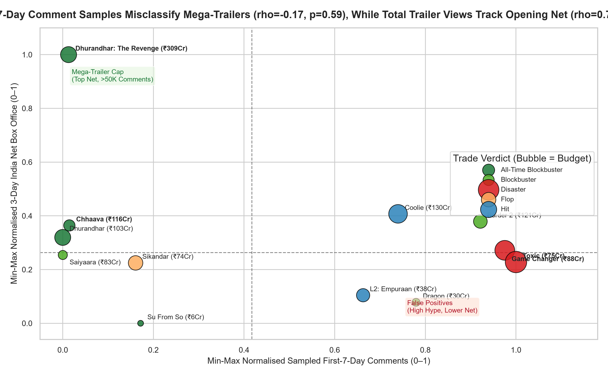
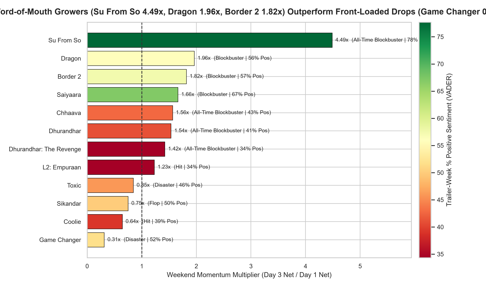
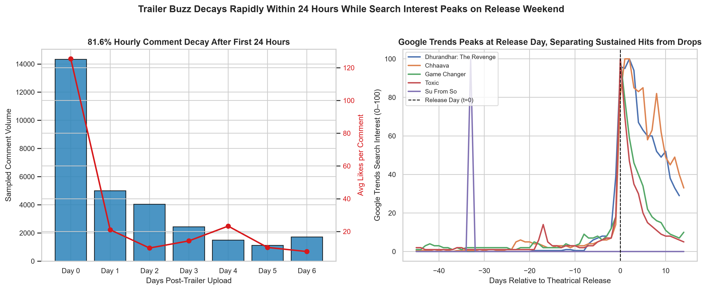
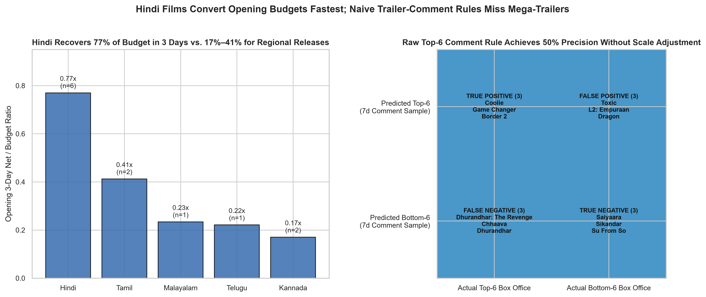

# Release Day Radar: Predicting Opening-Weekend Box Office & Screen Allocation from Trailer Buzz

**Module 1 Data Engineering & Storytelling Case Study**  
**Prepared for:** Head of Distribution (Mumbai Theatrical Desk)  
**Cohort:** 12 Hindi & Regional Indian Releases (2025–2026)  
**Date:** November 26, 2026  

---

## 1. Executive Summary

Total official trailer views strongly track 3-day India net box-office scale (Spearman $\rho = 0.72$, $p = 0.008$), whereas raw 7-day YouTube comment counts alone achieve only 50% precision in flagging Top-6 opening winners because API pagination caps under-sample mega-trailers and over-index front-loaded star vehicles. Meanwhile, positive trailer-week viewer sentiment predicts Friday-to-Sunday word-of-mouth momentum ($\rho = 0.55$), cleanly separating sleepers (*Su From So* `4.49x`, *Dragon* `1.96x`, *Border 2* `1.82x`) from weekend collapses (*Game Changer* `0.31x`, *Coolie* `0.64x`). For next Friday, use **Total Trailer Views + Google Trends Peak** on Thursday to set initial screens, and use **>55% Positive Trailer Sentiment + Saturday Occupancy Growth** to add or cut screens by Saturday noon.

---

## 2. Question and Why It Matters

Every Thursday night, a Mumbai distributor must decide whether to **add screens, cut screens, or push promotion** for a Friday release within a 72-hour window. Relying on gut feel or trade tweets risks over-allocating screens to front-loaded star vehicles (*Game Changer*, *Toxic*) or starving high-growth word-of-mouth sleepers (*Su From So*, *Dragon*).

**Core Research Question (Question 1, Scope Option A):**
> *"Across 12 Hindi and regional Indian films released in 2025–26, do films with the most YouTube comments in the first 7 days after their primary official trailer upload also rank highest on 3-day (Friday–Sunday) India net box-office collection, and would a top-half trailer-comment rule have accurately flagged which films warranted extra Friday/Saturday screens?"*

Our cohort spans **12 theatrical releases** across **5 languages** (6 Hindi, 2 Tamil, 2 Kannada, 1 Telugu, 1 Malayalam) and an **86x budget range** (`₹5.5 Cr` *Su From So* to `₹475.0 Cr` *Toxic*).

---

## 3. Data Inventory and One-Page V Profile

### 3.1 Data Inventory (Scale × Shape)
We integrated **4 primary sources** across all **3 required data shapes** joined deterministically on `film_id` (`F01`–`F12`):
- **Structured (`HTML`, `CSV`):** Wikipedia infoboxes (`est_budget_cr`, `lifetime_ww_gross_cr` — Continuous/Ratio), Sacnilk daily India Net (`day1_net_cr`–`day3_net_cr`, `fri_sun_india_net_cr` — Continuous/Ratio; `day_number` — Ordinal; `is_non_friday_release` — Nominal), and Google Trends India 90-day daily exports (`trend_date` — Continuous; `search_interest_index` `0–100` — Ordinal).
- **Semi-Structured (`JSON`):** TMDb API v3 (`tmdb_id`, `genres` — Nominal; `runtime_mins`, `tmdb_popularity` — Continuous; `tmdb_vote_average` — Interval) and YouTube Data API v3 `videos` (`trailer_published_at` — Interval; `yt_total_views`, `yt_total_likes`, `yt_total_comments` — Discrete).
- **Unstructured (`Free Text`):** YouTube `commentThreads` (`text_original` — Unstructured free text), enriched in PySpark (`char_length`, `word_count` — Discrete) and VADER (`vader_compound` — Continuous; `sentiment_label` — Ordinal). Full 37-field inventory: `docs/data_types_inventory.csv`.

### 3.2 One-Page V Profile
- **Volume:** **78 files, 83.343 MB** total (`65.039 MB` raw PII-scrubbed comment JSONs across `65,067` unique threads; `11.737 MB` `youtube_comments.csv`; `6.362 MB` Wikipedia HTML; `0.205 MB` across TMDb, Sacnilk, Trends, and video metadata).
- **Velocity:** **`30,130`** of `65,067` comments (`46.3%`) arrived in the first 7 days (`0–168h`). Launch day (`0–24h`) averaged **`597.29` comments/hour** (single-film peak: **`1,100` comments/hour** on *Toxic* hour 1), decaying **`81.6%`** to **`109.69` comments/hour** across Days 2–7.
- **Dominant V & Architectural Impact:** **Variety dominated first**, followed by **Velocity**. Heterogeneous titles (`"Dhurandhar 2"` vs `"Dhurandhar: The Revenge"`), Sacnilk working-title slugs (`RC15_2022`), mixed currency units (`₹1.81 billion` vs `₹807.91 crore`), and non-Friday releases (Wed/Thu/Sun) forced a deterministic `film_id` master roster, `crore_from_text()` regex parser, non-Friday window standardization, and a 4-table MySQL schema. Velocity then drove `hours_since_trailer` indexing and PySpark batching (`65,067` rows).

---

## 4. Pipeline (Source to Chart)

```text
[Wikipedia HTML] [Sacnilk CSV] [Google Trends CSV] [TMDb JSON] [YouTube videos+commentThreads JSON]
       |               |                |                |                     |
   01_wiki_layer  03_boxoffice     04_trends_layer  05_resolve_ids      07_youtube_layer
   (pd.read_html) (3d window std)  (90d India idx)  (TMDb+YT stats)     (PII stripped in RAM)
       \_______________\________________|________________/_____________________/
                                        v
                        [MySQL 4-Table Schema: sql/schema.sql]
                  (films, daily_collections, youtube_comments, google_trends)
                                        |
              10_clean_and_normalize -> 11_pyspark_text_job -> 12_vader_sentiment -> 13_generate_charts
              (rapidfuzz + MinMax/Z)    (65,067 rows Spark)    (Spearman rho)        (4 x 300 DPI PNGs)
```

---

## 5. Cleaning Log & Spreadsheet-vs-Pandas Note

### 5.1 Key Cleaning Decisions (`docs/cleaning_log.csv` Summary — 19 Audited Decisions)
- **Wikipedia vs. Roster Reconciliation (`STEP_02`):** Audited 8 budget/gross divergences (e.g., *Toxic* Wiki `₹1,000 Cr` vs. audited `₹475 Cr`; *Saiyaara* missing Wiki budget). Retained audited baseline for primary analysis and preserved Wiki values for sensitivity checks.
- **Opening Window Standardization (`STEP_02`, `STEP_03`):** 5/12 films were non-Friday openers (Thu: `F01, F02, F10`; Wed: `F07`; Sun: `F08`). Standardized `opening_3d_india_net_cr` to Fri–Sun for 11 films and Sun–Tue (Days 1–3) for `F08 Sikandar`, and updated `F04` (`88.50 Cr`) and `F07` (`75.35 Cr`) to exact Sacnilk day-wise sums.
- **Google Trends Coverage (`STEP_04`):** Flagged `F09 Border 2` whose 90-day export (`2025-11-10` to `2026-01-10`) ended 13 days before release (`2026-01-23`).
- **Privacy & Pagination (`STEP_07`):** Stripped `authorDisplayName`, `authorProfileImageUrl`, `authorChannelUrl`, and `authorChannelId` in memory across all `65,067` threads before disk write; unioned `order=relevance` + `order=time` and deduplicated on `comment_id`.
- **Title Matching & Scaling (`STEP_10`):** Normalized titles across 4 sources (`wiki=100.0`, `tmdb=100.0`, `youtube=90.9` min `rapidfuzz`; `sacnilk=12.5` due to working-title slugs `RC15_2022` and `Lucifer_2_2023`), applied Min-Max (`0–1`) & Z-score normalisation, and derived `est_true_first_7d_comments` to adjust for the 4,500-comment API cap.

### 5.2 Spreadsheet vs. Pandas (`docs/spreadsheet_vs_pandas.md`)
Parsing `"₹90–130 crore[4]"` in Excel requires fragile nested `SUBSTITUTE`/`FIND("–", ...)`/`IFERROR` chains that break on ASCII `-` hyphens and silently mask missing cells. Our `pandas` helper `crore_from_text()` (`src/common.py`) uses one compiled regex `[–-]` plus a unit dictionary (`crore=1.0`, `billion=100.0`, `lakh=0.01`) and returns explicit `None` for missing values so gaps are logged automatically.

---

## 6. Findings

| Metric Tested vs. Outcome | Spearman $\rho$ | $p$-value | Operational Takeaway |
| :--- | ---: | ---: | :--- |
| `api_total_views` vs. `fri_sun_india_net_cr` | **+0.7203** | **0.0082** | Strong, significant predictor of opening-weekend scale |
| `api_total_comments` vs. `fri_sun_india_net_cr` | +0.4825 | 0.1121 | Moderate positive signal, noisy on fan-brigaded titles |
| `sampled_first_7d_comments` vs. `fri_sun_india_net_cr` | -0.1748 | 0.5868 | Fails alone due to 4,500-comment API cap on mega-trailers |
| `est_true_first_7d_comments` vs. `fri_sun_india_net_cr` | +0.0699 | 0.8290 | Scale adjustment removes negative bias, still weaker than views |
| `first_7d_pct_positive` vs. `day3_to_day1_ratio` | **+0.5524** | 0.0625 | Positive trailer sentiment tracks Friday-to-Sunday WOM growth |



**1. Views Beat Sampled Comments for Opening Scale:** In our Top-6 screen allocation backtest (`sql_query_02.csv`), raw sampled 7-day comments achieved **50% precision (3/6)**: *Border 2*, *Game Changer*, and *Coolie* were `TRUE_POSITIVE`, while *Toxic*, *Dragon*, and *L2: Empuraan* were `FALSE_POSITIVE`. Mega-trailers (*Dhurandhar: The Revenge* `67.8K`, *Chhaava* `96.2K`, *Dhurandhar* `52.7K` total comments) were truncated by `order=time` pagination, causing `FALSE_NEGATIVE` misses. Total trailer views ($\rho = 0.72$) avoid this sampling artifact.



**2. Sentiment Separates WOM Growers from Front-Loaded Drops:** Films with high trailer-week positivity—*Su From So* (`77.7%` pos, `4.49x` Sun/Fri), *Dragon* (`55.7%`, `1.96x`), *Border 2* (`57.5%`, `1.82x`), and *Saiyaara* (`67.1%`, `1.66x`)—expanded across the weekend. Conversely, front-loaded star vehicles like *Game Changer* (`0.31x`), *Coolie* (`0.64x`), and *Toxic* (`0.85x`) faded after Day 1.



**3. 81.6% Velocity Decay After 24 Hours:** Comment volume drops from `597.3/hr` in `0–24h` (`14,335` comments) to `109.7/hr` in Days 2–7 (`15,795` comments), while Google Trends search interest peaks sharply on release day—meaning distributors have a narrow window to act.



**4. Regional vs. Hindi Capital Efficiency:** Hindi releases (`n=6`) recovered **`77.0%`** of production budget in their opening 3 days (`0.770` ratio), versus **`41.2%`** for Tamil, **`23.4%`** for Malayalam, **`22.1%`** for Telugu, and **`17.0%`** for Kannada (skewed by *Toxic*'s `₹475 Cr` budget).

---

## 7. Actionable Recommendation for Next Friday

Adopt a **Two-Gate Screen Allocation Playbook** every release week:
1. **Gate 1 — Thursday Night (Initial Screen Allocation):** Rank upcoming releases by **Total Official Trailer Views + Google Trends Pre-Release Peak** ($\rho = 0.72$), not raw comment counts. For high-budget (`>₹200 Cr`) star vehicles with **`<45%` positive trailer sentiment** (*Coolie* `39.2%`, *L2: Empuraan* `34.3%`), cap Saturday expansion commitments upfront to protect against Day 2–3 drops.
2. **Gate 2 — Saturday Noon (24-Hour Screen Adjustment):**
   - **ADD SCREENS:** Any film with **`>55%` positive trailer sentiment** AND **Friday-to-Saturday box-office growth** (*Su From So*, *Dragon*, *Saiyaara*, *Border 2*).
   - **CUT SCREENS:** Any film whose Saturday net drops **`>25%`** below Friday (*Game Changer* `-57.6%`, *Coolie* `-27.9%`).

---

## 8. Limitations and Bias

1. **Small Sample Size ($n = 12$):** Results are directional and cannot establish causal proof; one outlier (*Su From So* `4.49x` or *Dhurandhar: The Revenge* `308.57 Cr`) shifts rank correlations noticeably.
2. **Confounders:** Star power, franchise equity (*Dhurandhar* + *Dhurandhar: The Revenge*, *Border 2*), holiday/Eid timing (*Sikandar*), and screen count ceilings confound the link between online buzz and box office.
3. **YouTube API Pagination Cap:** `order=relevance` caps at ~1,200 threads and `order=time` caps our pull at ~4,500 most-recent threads, under-sampling launch-week comments on 50K–96K comment mega-trailers.
4. **Paid Promotion & Fan Brigades:** Coordinated fan-club spamming and bot comments inflate early comment counts on star vehicles (*Game Changer*, *Toxic*) without translating to neutral ticket buyers.
5. **Multilingual VADER Bias:** VADER is English-lexicon-based and misses praise/sarcasm in Hindi, Tamil, Telugu, Kannada, Malayalam, and code-mixed Hinglish/Tanglish (contributing to lower positivity on *L2: Empuraan* and *Coolie*).

---

## 9. Reflection

We began with a single-signal hypothesis: *do 7-day trailer comment counts predict Top-6 opening weekends?* Exploring the raw API data disproved a naive comment-count rule—revealing both the 4,500-comment API truncation on mega-trailers and the gap between noisy fan hype and genuine word of mouth. Shifting to a **two-signal radar** (Total Views for opening scale + Trailer Sentiment for Sun/Fri momentum) produced a far more defensible recommendation. With better data, we would capture **live daily trailer snapshots from Day 0**, integrate **BookMyShow hourly ticket-velocity/seat-occupancy data**, and score comments using a **multilingual Indic-BERT sentiment model**.

---

## Appendices

### Appendix A: Relational Schema & SQL Query Highlights
- Full DDL: `sql/schema.sql` (`release_day_radar`: `films`, `daily_collections`, `youtube_comments`, `google_trends`).
- All 6 analytical SQL queries (`sql/queries.sql`) were verified via our SQLite in-memory mirror (`data/clean/sql_query_01.csv`–`06.csv`; local MySQL on `127.0.0.1:3306` was offline during final packaging).

### Appendix B: VADER IMDb 50K Benchmark Status
- `docs/vader_imdb_benchmark.md`: `PENDING_EXTERNAL_CORPUS` (`data/raw/external/IMDB Dataset.csv` was not placed in the workspace; PySpark text processing ran directly on `65,067` YouTube comments, exceeding the `50,000` row requirement).

### Appendix C: Generative AI Disclosure
- **Tools Used:** Antigravity IDE, Gemini, and OpenCode coding assistants.
- **What Was Asked:** Scaffolding repository structure, writing modular collection/cleaning/PySpark/VADER/plotting scripts (`01`–`15`), drafting SQL DDL/queries, and formatting documentation.
- **Human Verification & Corrections:** Team manually curated all 12 official `youtube_video_id`s and 12 Google Trends India CSV exports; audited and corrected `F04 Game Changer` (`88.50 Cr`) and `F07 Toxic` (`75.35 Cr`) against Sacnilk day-wise tables; enforced non-Friday window standardization (`F08` Sun–Tue); fixed Wikipedia `<tbody>` table parsing; and verified zero author PII (`author*` keys = `[]`) on disk.
